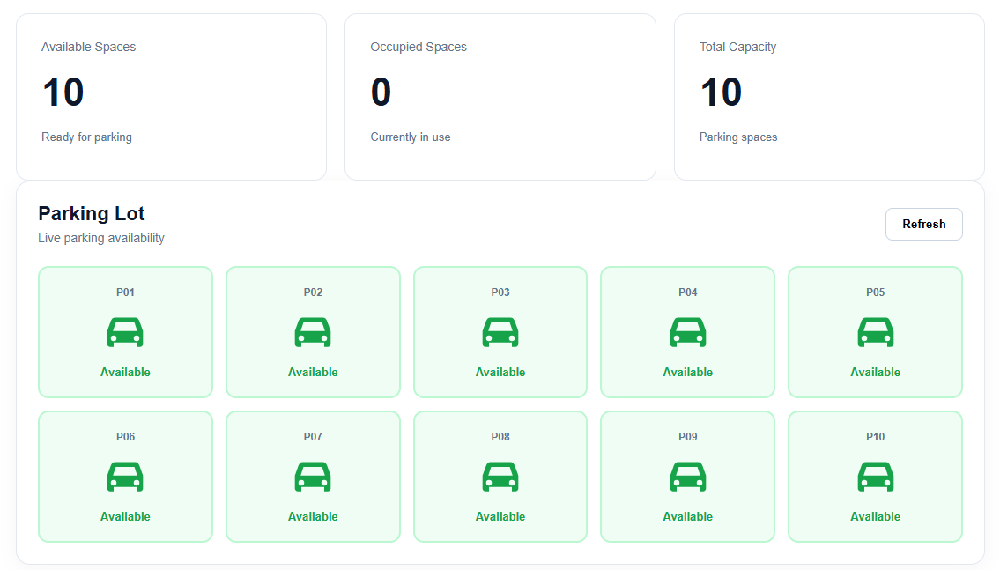
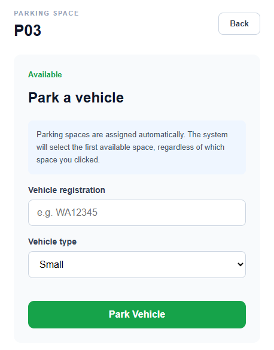
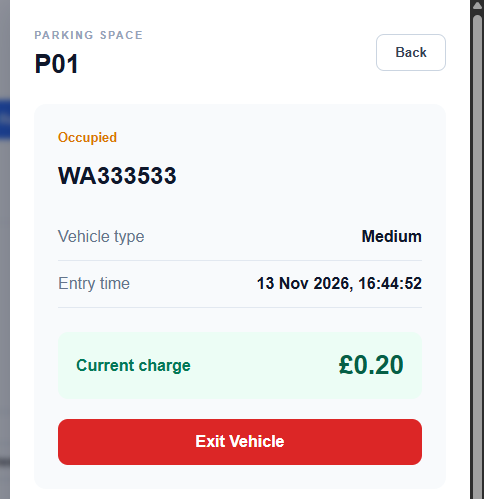

# CarPark Management API

A full-stack parking management application built with ASP.NET Core (.NET 10) and Angular 20. It manages parking availability, vehicle arrivals and departures, and time-based parking charges through a REST API and an interactive dashboard.

## Technology

**Backend and testing**

- .NET 10 / ASP.NET Core Web API
- Entity Framework Core with SQL Server LocalDB
- xUnit
- SQLite in-memory for service integration tests
- `WebApplicationFactory` and SQL Server LocalDB for HTTP integration tests
- Swagger / OpenAPI

**Frontend**

- Angular 20 and TypeScript
- SCSS
- Angular Signals and Reactive Forms
- HTTP client integration with the REST API

## Features

- Dashboard showing available, occupied, and total parking spaces.
- Interactive parking lot with individual space details.
- Register vehicle arrivals with registration number and vehicle type.
- Automatically allocate the lowest-numbered available space (selecting a space in the UI does not reserve that specific space).
- View active parking sessions, entry times, and current charges.
- Process vehicle departures and display the final charge.
- Form validation, API error messages, and operation notifications.

## Application screenshots

### Parking dashboard



### Park a vehicle



### Occupied parking space



## Requirements

- .NET 10 SDK
- Node.js and npm (for the Angular frontend)
- Windows with SQL Server Express LocalDB installed and an available `MSSQLLocalDB` instance
- EF Core CLI (`dotnet-ef`) to apply migrations (if not installed, install a compatible version)

> **Platform note:** The API and HTTP integration tests are configured to use SQL Server LocalDB, which is Windows-specific. The HTTP tests will not run unchanged on Linux or macOS.

## Setup and run

### Backend

From the repository root:

```bash
dotnet restore
```

Configure the connection string in `CarPark.Api/appsettings.json` (or override it through configuration):

```json
{
  "ConnectionStrings": {
    "DefaultConnection": "Server=(localdb)\\MSSQLLocalDB;Database=CarParkDb;Trusted_Connection=True;"
  },
  "Parking": {
    "Capacity": 10
  }
}
```

Apply the EF Core migrations before starting the API:

```bash
dotnet ef database update --project CarPark.Api --startup-project CarPark.Api
```

Then start the application:

```bash
dotnet run --project CarPark.Api
```

When running in the `Development` environment, Swagger UI is available at `/swagger` on the address printed by the application.

At startup, `ParkingDbSeeder` inserts numbered parking spaces if the database does not already contain any. Changing `Parking:Capacity` does not resize a previously seeded parking lot.

### Frontend

With the backend running, open another terminal from the repository root:

```bash
cd carpark-ui
npm install
npm start
```

Open `http://localhost:4200`. Ensure the frontend API base URL in the Angular environment configuration matches the running backend address. The backend must allow the frontend origin through its CORS configuration.

## API

| Method | Endpoint | Purpose |
| --- | --- | --- |
| `GET` | `/parking` | Current parking availability |
| `GET` | `/parking/spaces` | All parking spaces and occupancy |
| `GET` | `/parking/spaces/{spaceNumber}` | Details of one parking space |
| `POST` | `/parking` | Park a vehicle |
| `POST` | `/parking/exit` | Complete a parking session |


### `POST /parking`

Park a vehicle in the lowest-numbered available space.

Request:

```json
{
  "vehicleReg": "WA12345",
  "vehicleType": 1
}
```

Example `200 OK` response:

```json
{
  "vehicleReg": "WA12345",
  "spaceNumber": 1,
  "timeIn": "2026-11-13T10:00:00Z"
}
```

Vehicle types: `1` = Small, `2` = Medium, `3` = Large.

### `GET /parking`

Get the current occupancy.

Example `200 OK` response (assuming 10 spaces and one active parking session):

```json
{
  "availableSpaces": 9,
  "occupiedSpaces": 1
}
```

### `POST /parking/exit`

Complete a vehicle's active parking session, calculate its charge, and release the space.

Request:

```json
{
  "vehicleReg": "WA12345"
}
```

Example `200 OK` response (Small vehicle, exactly 10 minutes):

```json
{
  "vehicleReg": "WA12345",
  "vehicleCharge": 3.0,
  "timeIn": "2026-11-13T10:00:00Z",
  "timeOut": "2026-11-13T10:10:00Z"
}
```

### Error responses

- `400 Bad Request`: invalid arguments, such as an unsupported vehicle type.
- `409 Conflict`: a business-rule conflict, such as an already parked vehicle, no available spaces, or an exit without an active parking session.

Error responses generated by the controller include a `message` field. ASP.NET Core model validation may produce its standard validation response instead.

## Pricing

| Vehicle type | Value | Rate per minute |
| --- | ---: | ---: |
| Small | 1 | £0.10 |
| Medium | 2 | £0.20 |
| Large | 3 | £0.40 |

Parking duration is rounded **up** to a whole minute. An additional **£1.00** is charged for every complete five-minute block of that rounded duration.

```text
minutes = ceil(duration in minutes)
fiveMinuteBlocks = minutes / 5  (integer division)
charge = minutes * vehicleRate + fiveMinuteBlocks * £1.00
```

For a Small vehicle:

| Actual duration | Charge |
| --- | ---: |
| 1 minute | £0.10 |
| 4 minutes | £0.40 |
| 5 minutes | £1.50 |
| 10 minutes | £3.00 |
| 10 minutes and 1 second | £3.10 |

## Tests

The backend has automated xUnit tests. Frontend behavior has been checked manually through the Angular dashboard; no automated frontend test suite is included in the current scope.


Run all tests from the repository root:

```bash
dotnet test
```

The test suite includes:

- **Unit tests:** parking charge calculation without a database.
- **Service integration tests:** `ParkingService` and EF Core using isolated SQLite in-memory databases.
- **HTTP integration tests:** requests through `WebApplicationFactory`, ASP.NET Core controllers, services, EF Core, and SQL Server LocalDB.

The HTTP test factory uses a unique `CarParkTest_<GUID>` database per factory instance. It applies EF Core migrations, the application's startup seeder creates three parking spaces, and disposal attempts to delete the temporary database. These tests require a working LocalDB instance and permissions to create and delete databases.

## Design choices and assumptions

- Business operations are implemented in `ParkingService`; controllers handle HTTP requests and responses.
- EF Core is used directly without an additional repository abstraction.
- Vehicle registration numbers are normalized to uppercase.
- The lowest-numbered available parking space is allocated first.
- Only one active parking session is allowed per vehicle and per parking space; filtered unique indexes enforce these constraints at the database level.
- A completed parking session frees its space for another vehicle.
- `TimeProvider` supports deterministic tests for time-based behavior.
- The pricing algorithm uses `decimal` internally; the exit API exposes `vehicleCharge` as a number.
- Parking capacity is configured through `Parking:Capacity` and seeded only when no spaces exist.

## Scope

This is a small full-stack parking management project focused on clear business rules, persistence, validation, a usable Angular interface, and automated backend testing. It intentionally avoids unnecessary architectural layers and infrastructure.
